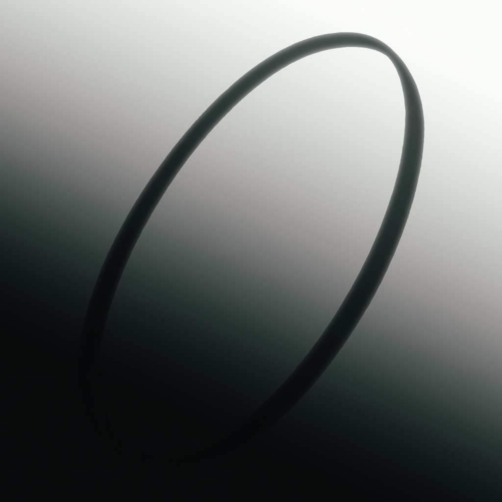

> **Apple development branch (`apple/sandbox-sync`):** This branch adds native
> iOS/iPadOS support and sandboxed **Halo.app** builds to the Apple fork below.
> Use [our Apple build instructions](docs/apple-build.md) for bundle IDs, private
> ISO imports and opt-in GameSave. The upstream release links and unsandboxed
> storage paths below describe upstream builds, not this branch's local builds.
> See [the October 22 integration record](docs/upstream-review-2026-10-22.md)
> for the current baseline and validation limits.

# CoreCE: Halo: Combat Evolved for Linux, Windows, and macOS

  

  

  
  
  

  

**CoreCE** is an open source port of the Halo: Combat Evolved decompilation, from Xbox development build 2342 and [bnunu/halo-1](https://github.com/bnunu/halo-1). Windows, Linux, and Apple Silicon each run the game's own code, with a new layer in place of the Xbox hardware. Windows and Linux draw with OpenGL. The Mac build draws with Metal. Sound, input, and gamepads go through SDL3.

You can play with up to 128 players, run campaign co-op online, load Custom Edition maps, change the field of view, browse servers, host peer-to-peer, download missing maps, and use voice chat. With Smooth Motion on, the game draws a frame for every refresh of the display. The simulation stays at 30 ticks a second, as on the Xbox.

## Download

The Mac button downloads build 42 (`CoreCE-macos-arm64.dmg`). The Windows button downloads build 10 (`halo-windows-release.zip`). The Linux button downloads `halo-linux-release.zip` from `linux-net34-8`. Each system is published on its own. Older builds are on the [releases page](https://github.com/mastercheese-dev/CoreCE/releases).

| System | Download this | Then |
| --- | --- | --- |
| Mac | The newest `CoreCE-macos-arm64` disk image | Open it and drag **CoreCE.app** into Applications |
| Windows | The newest `halo-windows-release.zip` | Unzip it and run `halo.exe` |
| Linux | The newest `halo-linux-release.zip` | Unzip it and run `halo` |

The release title names the network protocol. Everyone in a game needs the same number. A game on the original rules can include another player whose build speaks that protocol. [PB Options](docs/performance-options.md) and Match Options need a build from these releases.

### Mac

The Mac build is for Apple Silicon and macOS 26 or later. The disk image is enough to run the game.

1. Download the newest `CoreCE-macos-arm64` disk image.
2. Open it and drag **CoreCE.app** into Applications.
3. Open CoreCE from Applications.
4. The app is ad hoc signed. The first time, macOS may leave it blocked. After you try to open it, allow it in **System Settings**, under **Privacy & Security**. [Apple's steps](https://support.apple.com/en-us/102445) walk through that screen.

On Mac, the helmet in the menu bar opens Settings. Command-comma does the same. F12 releases the mouse so you can reach the menu bar. Escape pauses.

### Windows

1. Download the newest `halo-windows-release.zip`.
2. Unzip it into its own folder.
3. Run `halo.exe`. Leave `SDL3.dll` in that same folder.

Settings live in `config.toml` next to `halo.exe`. Saves go in `%APPDATA%\Halo OG`. The first launch copies an older `%APPDATA%\halo` folder into that location and leaves the old folder in place.

### Linux

1. Download the newest `halo-linux-release.zip`.
2. Unzip it into its own folder and run `halo`.
3. The zip brings its own SDL3 (`libSDL3.so.0`). Install the 32-bit OpenGL libraries, the 32-bit PipeWire or PulseAudio client, and the 32-bit X11 libraries. SteamOS already has them. Package names, glibc, and Wayland are in the [Linux README](port/linux/README.md), along with controls and settings. Most of the controls and settings are the same on every platform.

Arch Linux can install the [AUR package](https://aur.archlinux.org/packages/CoreCE-bin) and skip the zip.

On a Steam Deck, do the setup in Desktop Mode. Unzip the release, then in Steam open the Games menu, choose Add a Game, and add `halo` as a non-Steam game. It then starts from Game Mode as well. If the Deck sleeps while it is hosting, the other players lose the host after 15 seconds.

Settings live in `config.toml` next to `halo`. Saves go in `~/.local/share/halo-og`. The first launch copies an older `~/.local/share/halo-linux` folder into that location and leaves the old folder in place.

### Updates

On Mac, the app checks this releases page for a newer disk image and asks before installing it.

On Linux and Windows, download a newer zip from the same page and replace the program files. Leave maps, saves, and `config.toml` where they are. If the game offers an update, **Yes** replaces the program files and keeps the previous copies with a `.old` name until the next start. **No** asks again next time. **Do not ask again** writes that choice into `config.toml`. A build you compile yourself has no build number and does not ask.

## Your own copy

Bring your own copy of the game. The download has no game data.

1. Start the game (`CoreCE.app` on Mac, `halo.exe` on Windows, `halo` on Linux).
2. The first time, choose your copy in the file picker. On Linux and Windows, a `maps` folder already sitting next to the program is used and the picker stays closed.
3. On Linux and Windows, No on that question stops the game. Put a `maps` folder next to the program, or set `paths.data` in `config.toml`, and start again.
4. On Mac, a folder of the game offers **Copy and Manage**, **Use This Folder**, or **Cancel**. Managed copies go under `~/Library/Application Support/CoreCE/Game Data/`. Saves, profiles, and `config.toml` stay in that Application Support directory.
5. The game sets up `maps` from your copy, then starts.

If an older Mac build left files behind, CoreCE copies the first folder it finds, in this order: `OpenCE`, then `Halo OG`, then `Halo CE Universal`. Files already in the CoreCE folder stay. The older folder stays where it is. If the copy cannot finish, the app explains the error and stops, so the next launch can try again.

Put the Xbox maps in `maps`. Put Custom Edition maps in `custom_maps`, beside `maps`. If `maps` contains Halo PC maps, the game explains that and stops.

On Linux and Windows, `maps` sits next to the executable. You can also set `paths.data` in `config.toml` to a folder you already have. On Mac, the same choices are described in [Mac data import](docs/macos-menu-and-releases.md#independently-supplied-data).

## Multiplayer

- **Up to 128 players** on up to 128 machines, and up to 4 players on one device in split screen.
- **Windows, Linux, and Mac play together.** On a local network they can play LAN.
- **Peer-to-peer internet hosting.** Join through the server browser or an invite link. A host lists a game as public, or keeps it private for players with the invite. With Discord, the host can send the invite through Discord.
- **Online co-op campaign,** with friendly fire, player collisions, and more enemies as the player count grows.
- **Voice chat:** push to talk (V) or an open microphone, changed in the audio settings.
- **Map sharing:** a player missing the game's Custom Edition map downloads it from the other players.
- **Moderation:** the host can kick and ban from the scoreboard, or with the `kick` and `ban` console commands. Players can vote to kick.
- **Scrollable scoreboard:** the mouse wheel or Page Up and Page Down moves through a large lobby.
- **Netcode:** each machine moves its own player at once, and the host decides the game. See [port/linux/NETCODE.md](port/linux/NETCODE.md).

## Custom Edition maps

Put Halo Custom Edition maps in `custom_maps`, beside `maps`. That folder also needs `bitmaps.map`, `sounds.map`, and `loc.map` from your installed copy of Halo Custom Edition. On Mac, put `custom_maps` beside the Xbox `maps` folder the game is using, including a managed copy under Application Support.

The Gearbox maps that shipped with Halo PC (Ice Fields, Death Island, Danger Canyon, Infinity, Timberland, and Gephyrophobia) are a separate set. Copy them from a Halo Custom Edition install's `maps` folder into `custom_maps`. They then appear under Custom Singleplayer and Custom Multiplayer. A custom singleplayer map plays as a campaign level, alone or as online co-op. Maps that require OpenSauce will not load.

The server browser and the LAN browser can download a missing custom map from the other players, including `bitmaps.map`, `sounds.map`, and `loc.map`. This works on a LAN, and on the internet when the host has map sharing on (the default). See [docs/custom_edition_caches.md](docs/custom_edition_caches.md).

## Community maps and competitive options

Mac Settings can download 40 approved community maps in the background after you opt in. The collection is about 863 MiB, built for Xbox v5 NTSC data. Verified downloads stay usable offline. Windows and Linux currently install matching maps by hand. See [community-map setup](docs/playtesting.md#community-maps).

**PB Options** offers spawn markers, timer announcements, and optional silent movement and weapon-ready sounds. Those modifications default off. The host chooses them. Use **Stock** for original-rule play. The match clock is each machine's Graphics setting: Off, On, or On with Voice. On with Voice plays the countdown shipped with the game. See [PB Options](docs/performance-options.md).

**Match Options**, on the game type, covers movement sounds, training, camouflage, team scores, weapon spread, and field of view. The host's choices apply to the game. Default field of view leaves each player's Graphics setting.

## Graphics

The game keeps the Xbox look until a setting says otherwise.

**Display**

| Option | What it does | Default |
| --- | --- | --- |
| DISPLAY MODE, RESOLUTION, WINDOW SIZE | Fullscreen, borderless, or windowed. F11 switches mode. | Borderless, at the display's resolution |
| RESOLUTION SCALING | Draw at the window's resolution, or at the Xbox's 640x480 and scale it up | Native |
| V-SYNC, FRAME RATE LIMIT | Wait for the display, or run free up to a frame cap | V-sync on |
| SMOOTH MOTION | A frame for every refresh, blended between the game's 30 ticks a second | Off |
| INSTANT AIM | In first person, the view turns the frame the mouse moves | Off |
| FOV | On-foot field of view, from 80 to 150 degrees. The weapon and hands keep the original view | Stock |

**Image quality**

| Option | What it does | Default |
| --- | --- | --- |
| ANTI-ALIASING | FXAA, SMAA, MSAA, or SSAA | Off, as on the Xbox |
| SHADOW RESOLUTION | Object shadows at 128 (the Xbox's), 256, 512, or 1024 pixels | 128 |
| PER-PIXEL LIGHTING | Lights models for each pixel | Off |
| MODEL DETAIL | Stock uses the Xbox's 480 lines. Native uses this display. Highest keeps the most detail. | Stock |
| HIGH-RES HUD, BUTTON STYLE, HIGH-RES TEXT | Redrawn HUD art, button art, and text that stay sharp when scaled | On for the high-res HUD and text |
| CAMPAIGN HUD | On a custom map, draw the campaign HUD. The reticle stays the map's. | Off |
| MATCH TIMER | A clock at the bottom right in multiplayer. On with Voice also plays the countdown | Off |

**Extras**

| Option | What it does | Default |
| --- | --- | --- |
| SHIELD GLOW, GLOW INTENSITY | Energy shields light what is around them as they flare | Off |
| SHIELD COLOR | Your own shield in a multiplayer armor color, as your machine draws it | Default |

## How to build

You do not need the Xbox SDK. The port supplies the declarations the game uses. See [port/include/xdk](port/include/xdk/README.md).

1. Install Python and [ninja](https://ninja-build.org/).
2. Install the tools for your platform. See that platform's README.
3. From the repository root, run `python configure.py`.
4. Build a target:

| Target | Result |
| --- | --- |
| `ninja linux` | `build/linux/halo` |
| `ninja windows` (on Windows) | `build/windows/halo.exe` and `SDL3.dll` |
| Mac | [Apple setup](docs/apple-build.md). The Mac build uses LLVM 22 and `tools/macos_build.py`. |

### Build options

`python configure.py --release` builds a release, which keeps going past assertions. A debug build stops at the first failed check and writes it to the log. `--portable` makes a Linux or Windows build that starts on other x86-64 machines. Without it, those builds use the instructions of the machine that compiled them.

The experimental [iPhone port](port/ios/README.md) is a developer build. These releases have no iPhone package.

## Credits

The decompilation is of Xbox build 2342. CoreCE starts from [OpenCE](https://github.com/OpenCommunityEdition/OpenCE) and [bnunu/halo-1](https://github.com/bnunu/halo-1), a fork of [punpckhdq/halo](https://github.com/punpckhdq/halo). High-res redraw artists are in [AUTHORS.md](AUTHORS.md). This tree reviews upstream changes one by one.

## Licence

This fork is released under [CC0 1.0](LICENSE.md). Third-party code, fonts, and art keep the licences next to them.

## Disclaimer

CoreCE is an unofficial fan project. It is not endorsed by or affiliated with Microsoft, Xbox Game Studios, Halo Studios, Activision, or Bungie. Halo and Halo: Combat Evolved are trademarks of Microsoft Corporation. Halo is copyright Microsoft Corporation.

Bring your own copy of the game. The download has no game data.
